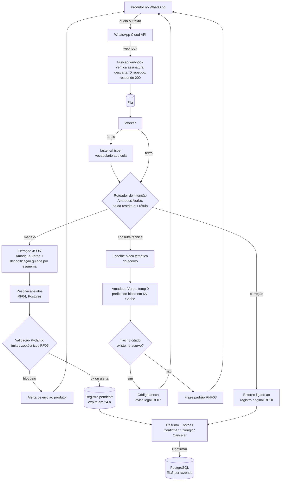

# Arquitetura e custo estimado (passo 2)

2 de novembro de 2026 · Edídio

Proposta: um backend serverless leve (webhook, fila, banco) e **um único contêiner de GPU L4** com vLLM (Amadeus-Verbo 7B) e faster-whisper. O contêiner fica aquecido nos horários de manejo e escala a zero no resto do dia. Com 15 horas aquecidas por dia, o custo estimado é de **cerca de US$ 370 por mês**, ou cerca de US$ 0,012 por requisição para 1.000 requisições por dia. A meta original de "frações de centavo por consulta" só é atingível reduzindo as horas aquecidas ou dividindo a GPU entre mais clientes (ver a seção 4).

## 1. Fluxo do áudio até o banco

As três camadas de proteção aparecem em sequência: a validação por código (VAL), a confirmação humana (BTN) e a barreira de citação com aviso (CIT e DIS).

## 2. Componentes

| Componente | Escolha proposta | Por quê |
| --- | --- | --- |
| Entrada | WhatsApp Cloud API (Meta), oficial | Botões interativos nativos. Mensagens de atendimento dentro da janela de 24 h são gratuitas ([Meta](https://developers.facebook.com/docs/whatsapp/pricing)). |
| Webhook e worker | Função serverless (Modal, Cloud Run ou AWS Lambda) | Custo perto de zero com 1.000 requisições por dia. O webhook só enfileira, para responder rápido à Meta. |
| Fila | Fila gerenciada (SQS, Cloud Tasks ou a fila do Modal) | Garante o processamento assíncrono do RNF06 e novas tentativas em caso de falha. |
| Transcrição | faster-whisper (large-v3-turbo) no mesmo contêiner de GPU | O áudio não sai da infraestrutura do projeto (RNF07). O vocabulário aquícola vai no prompt inicial. |
| Modelo de linguagem | Amadeus-Verbo-MI 7B em vLLM, bf16 | O modelo é baseado no Qwen2.5 e tem licença Apache-2.0 ([relatório técnico](https://arxiv.org/abs/2506.00019), [Hugging Face](https://huggingface.co/amadeusai/Amadeus-Verbo-FI-Qwen2.5-14B-PT-BR-Instruct)). O cache automático de prefixo do vLLM atende o RNF05. |
| Saída estruturada | Decodificação guiada do vLLM com o esquema JSON do RF03 | O modelo não consegue gerar um JSON fora do esquema. O Pydantic valida as regras de negócio depois. |
| Banco | PostgreSQL gerenciado, com criptografia em repouso e row-level security | Isola cada fazenda (RNF07). |
| Áudios | Armazenamento de objetos com regra de expiração de 90 dias | Trilha de auditoria (RNF09) e retenção da LGPD (RNF07). |
| Acervo | Blocos temáticos em Markdown, versionados neste repositório | Versionamento do acervo (RNF10). Cada bloco cabe em até metade da janela efetiva do modelo. |

## 3. Dimensionamento da GPU

- O Amadeus-Verbo 7B em bf16 ocupa cerca de 15 GB. O Qwen2.5-7B usa cerca de 56 KB de KV-Cache por token (28 camadas, 4 cabeças KV de dimensão 128). Assim, um bloco de 40 mil tokens ocupa cerca de 2,3 GB. O faster-whisper turbo ocupa cerca de 2 GB. Tudo cabe numa L4 de 24 GB, com folga para algumas perguntas simultâneas.
- O 14B em bf16 ocupa cerca de 30 GB e precisa de uma L40S (48 GB). Por isso, o 14B só entra se o 7B não atingir a meta de acurácia do RNF01.
- Os números de memória são estimativas e devem ser medidos com o vLLM antes de fixar a GPU.

## 4. Custo mensal estimado (1.000 requisições por dia)

Preços por segundo da GPU no Modal, consultados em 2 de novembro de 2026: L4 a US$ 0,000222/s e L40S a US$ 0,000542/s ([Modal](https://modal.com/pricing)). Mês de 30 dias.

| Cenário | GPU | Horas aquecidas por dia | GPU por mês (US$) | Custo por requisição (US$) |
| --- | --- | --- | --- | --- |
| Recomendado | L4, modelo 7B | 15 h (5h às 20h) | ~360 | ~0,012 |
| Econômico | L4, modelo 7B | 8 h (dois turnos de manejo) | ~190 | ~0,006 |
| Modelo maior | L40S, modelo 14B | 15 h | ~880 | ~0,029 |

Somam-se a isso valores aproximados que não conferi em tabela de preços: backend e fila (menos de US$ 10 por mês), PostgreSQL gerenciado (de US$ 0 a US$ 25 por mês) e armazenamento de áudio (menos de US$ 1 por mês). As respostas no WhatsApp dentro da janela de 24 horas são gratuitas. Os alertas ativos fora da janela usam modelos de mensagem, que são cobrados por mensagem. O plano Starter do Modal inclui US$ 30 por mês em créditos, e há bolsas para uso acadêmico.

Fora do horário aquecido, a primeira mensagem sofre uma partida a frio: o modelo precisa ser carregado (estimo de 30 a 90 segundos) e o bloco do acervo, reprocessado. Por isso, o RNF08 prevê um aviso imediato e resposta em até 3 minutos nesses horários.

## 5. Próximo passo (passo 3)

Montar o plano do MVP: fases, critérios de aceite de cada RF e RNF, e a coleta dos 200 áudios reais para o teste do RNF01. As decisões em aberto no fim de [especificacao-v2.md](especificacao-v2.md) (teto de custo, espécies, quem assina os limites) definem o tamanho do acervo e o cenário de custo.
